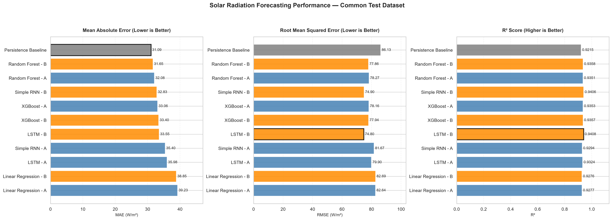

# Solar Radiation Prediction Using Meteorological Data

## Project Overview

This project investigates **five-minute-ahead solar radiation forecasting** using meteorological observations from the NASA HI-SEAS weather station in Hawaii. It combines data-quality assessment, exploratory data analysis (EDA), missing-data reconstruction, and comparative forecasting to examine whether more complex models and hybrid training data improve predictions over a simple persistence benchmark.

The work was developed for the **Big Data and Energy Data Analysis** course in the MSc Sustainable Energy Future programme at ECE.

## Research Objectives

- Examine solar radiation distributions, temporal patterns, and relationships with meteorological variables.
- Clean and prepare time-indexed observations for forecasting.
- Assess missing-data handling and construct a hybrid dataset containing observed and reconstructed training information.
- Compare conventional machine learning and recurrent neural networks against a persistence baseline.
- Evaluate model performance on a **common set of genuine observed test targets**, including performance under different radiation conditions.
- Discuss the implications for short-term solar-energy planning and the limits of the findings.

## Dataset and Attribution

- **Dataset:** Solar Radiation Prediction
- **Source:** [Kaggle — Solar Energy](https://www.kaggle.com/datasets/dronio/SolarEnergy)
- **Station:** NASA HI-SEAS weather station, Hawaii
- **Target:** Solar radiation, measured in W/m²
- **Other variables:** Temperature, humidity, atmospheric pressure, wind speed, wind direction, and time-related information
- **Original local file:** `data/Solar_Radiation_Prediction.csv`

The original CSV is tracked in the repository. The reconstructed file, `data/processed/solar_radiation_hybrid_reconstructed.csv`, is generated by the notebook and is **not** tracked by Git.

## Experimental Design

The study compares two training-data strategies:

- **Experiment A — Observed-only:** Models are trained using genuine observed training data.
- **Experiment B — Hybrid:** Models are trained using observed and reconstructed training data.

Both experiments are evaluated against the **same genuine test observations**, avoiding the use of reconstructed target values for the final comparison.

Six forecasting approaches are represented by **11 evaluated configurations**:

| Forecasting approach | Configurations |
|---|---|
| Persistence baseline | One benchmark |
| Linear Regression | A and B |
| Random Forest | A and B |
| XGBoost | A and B |
| Simple RNN | A and B |
| LSTM | A and B |

The evaluation uses MAE, RMSE, and R², together with error-distribution and radiation-condition analyses. Model ranking depends on the chosen metric; no single configuration is best on every criterion.

## Key Results

The common final evaluation contains **6,135 observed test samples**.

| Selection criterion | Best-performing configuration | Result |
|---|---|---:|
| Lowest MAE | Persistence Baseline | **31.09 W/m²** |
| Lowest RMSE | LSTM — Experiment B | **74.80 W/m²** |
| Highest R² | LSTM — Experiment B | **0.9408** |

The persistence baseline is the preferred choice when minimizing **average absolute error** and computational complexity are primary priorities. The hybrid LSTM performs best on **RMSE and R²**, indicating a different advantage when larger errors and explained variation matter. Random Forest is also a competitive conventional machine-learning alternative.

The condition-specific analysis shows that model performance varies between low, moderate, and high radiation. These findings support **metric- and application-dependent model selection**, rather than assuming that the most complex architecture is always preferable.



## Notebook and Repository Structure

```text
Final_Project_Solar_Radiation_Prediction/
├── .gitignore
├── README.md
├── requirements.txt
├── data/
│   ├── Solar_Radiation_Prediction.csv
│   └── processed/                 # Generated reconstruction output
├── figures/                       # Exported visualizations
├── models/                        # Reserved for model artifacts
├── notebook/
│   └── Solar_Radiation_Analysis.ipynb
└── presentation/                  # Reserved for presentation files
```

The notebook contains seven main sections, progressing from project setup and data preparation through exploratory analysis, forecasting experiments, comparative evaluation, and final conclusions.

## Software Environment

The analysis was run in an Anaconda-managed Jupyter environment on Windows using **Python 3.14.6**. The verified direct-package versions are listed in `requirements.txt`, including NumPy, Pandas, scikit-learn, XGBoost, TensorFlow, and Jupyter.

**Environment note:** The recorded TensorFlow version is `2.22.0rc0` (a release candidate). These versions document the working environment but have **not yet been tested as a clean installation on another computer**. Deep-learning results may vary slightly across runs and hardware configurations.

## Running the Project

1. Clone the repository:

   ```bash
   git clone https://github.com/damisar/Solar-Radiation-Prediction.git
   cd Solar-Radiation-Prediction
   ```

2. Create and activate a compatible Python environment. Use the Python version recorded above if recreating the original environment.
3. Install the declared dependencies:

   ```bash
   python -m pip install -r requirements.txt
   ```

4. Ensure `data/Solar_Radiation_Prediction.csv` is present.
5. Launch Jupyter with the **`notebook/` directory as the working directory**. For example, from the repository root:

   ```bash
   cd notebook
   jupyter notebook Solar_Radiation_Analysis.ipynb
   ```

6. Execute the notebook **in order, starting from the beginning**. The reconstruction workflow includes **Section 3.5.19 — Export Final Reconstructed Dataset**, which creates `data/processed/solar_radiation_hybrid_reconstructed.csv` from the reconstructed dataframe. Continue through the model-training and evaluation sections.

**Important path requirement:** The export code uses `Path.cwd().parent` to determine the project root. Launching the notebook from `notebook/` is therefore important for saving generated data in the expected project folder. Some generated figures also depend on notebook-relative paths.

**Reproducibility status:** The project has been run in its development environment, but a complete clean-environment, restart-and-run-all verification remains to be performed. Neural-network training can be time-consuming.

## Study Limitations

- Results reflect a specific weather-station dataset, available observation period, and **five-minute forecasting horizon**; they should not be generalized automatically to other climates, seasons, or lead times.
- Missing-data reconstruction changes the training information available to models; its benefits are not uniform across model families or radiation conditions.
- The comparison uses the selected features, architectures, and training settings. Broader hyperparameter searches or other architectures could change the rankings.
- The study does not establish that observed metric differences are statistically significant.
- Solar radiation forecasts are **not direct photovoltaic electricity-generation forecasts**; PV conversion would require system and operating information.

## Future Work

Future research could evaluate additional sites and longer observation periods, compare multiple forecast horizons, conduct walk-forward validation and statistical comparisons, test alternative reconstruction and model configurations, and incorporate cloud or satellite information. A subsequent application could connect irradiance predictions to PV system characteristics to estimate electricity output and evaluate operational value.

## Project Status

**Main notebook analysis and conclusions completed.** Repository documentation and dependency versions have been updated; independent reproducibility checks and final submission review remain pending.

## Author

**Rasaq Oluwasegun Damisa**

## Academic Context

**Course:** Big Data and Energy Data Analysis  
**Programme:** MSc Sustainable Energy Future, ECE  
**Academic year:** 2026–2027
